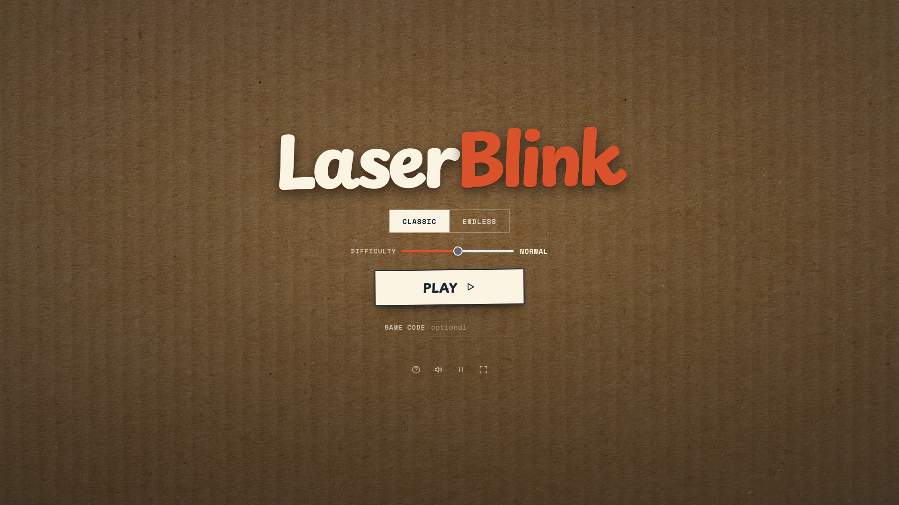

<div align="center">

# Laser · Blink

### A memory game of paper targets and one laser.

### [laserblink.bittu.dev](https://laserblink.bittu.dev)



</div>

## how to play

Targets sit on the field for a few seconds, then vanish. You get one shot. The beam bounces off the screen edges, mirrors and rulers, and burns whatever paper it passes through.

Classic is ten levels with three mistakes. Miss the quota and you lose one. The quota is 60% of the targets: two of three, five of seven.

When you don't burn everything, the ideal solution is shown.

## controls

- drag anywhere to aim
- left click, tap, or `Space` to fire and to advance
- `←` `→` or `A` `D` turn the turret, `Shift` is the fine step
- `I` spends an assist and shows the whole reflected line
- `M` sound, `V` less motion, `F` fullscreen, `?` help
- `Esc` opens the exit sheet

## modes

Classic stops at level ten. Endless keeps going at the top of the curve and has no mistake budget, so you end it yourself instead of losing it.

There are also 5 difficulty levels which decide what props are shown to you on scrren, like the blockers, reflectors and absorbers.


## Self-Host

```bash
npm install
npm run dev
```

```bash
npm run check
npm run build
```

## built with

Svelte 5, Vite, Tailwind, Canvas 2D, Web Audio.
